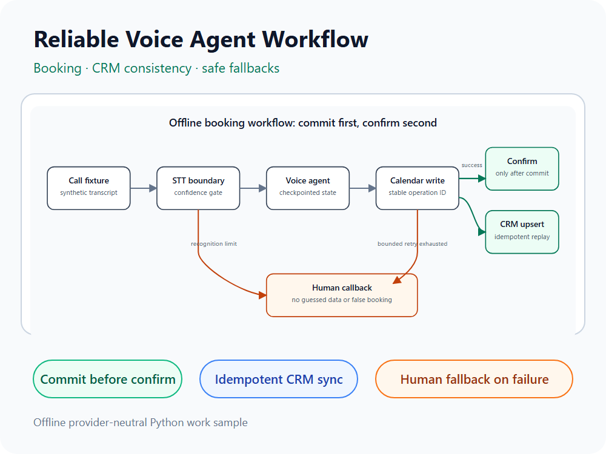

# Local Voice Agent Booking Demo

**A reproducible, offline call flow turns a caller's request into a calendar booking and an
idempotent CRM update, while routing speech and calendar failures to a safe callback path.**

This repository is a local evidence project for a bounded appointment-setting voice agent. It
models the same boundaries used by a hosted telephony stack—call turns, STT, agent state, TTS,
calendar booking, CRM upsert and human fallback—without making a real call, using credentials,
charging an account or contacting anyone.



The editable cover source is [portfolio-cover.svg](docs/portfolio-cover.svg); its embedded flow
source is [booking-flow.svg](docs/booking-flow.svg).

## 60-second demo

Python 3.11+ is required. The runtime itself has no third-party dependencies.

```powershell
python -m pip install -e ".[dev]"
$env:VOICE_AGENT_TRACE_HMAC_KEY = & python -c "import secrets; print(secrets.token_urlsafe(48))"
voice-agent-demo evaluate fixtures/calls --output reports/evaluation.json
$report = Get-Content -Raw reports/evaluation.json | ConvertFrom-Json
"scenarios=$($report.summary.passed)/$($report.summary.scenarios); controls=$($report.hardening_summary.passed)/$($report.hardening_summary.controls)"
```

Expected summary:

```text
scenarios=3/3; controls=5/5
```

The evaluation runs three deterministic paths:

1. complete discovery → available slot → booking → CRM upsert;
2. calendar provider failure → no false confirmation → callback request;
3. repeated STT failure → bounded retry → callback request.

It also checks retry/resume, concurrent duplicate convergence, trace redaction and environment-key
separation. To inspect one redacted call trace:

```powershell
voice-agent-demo run fixtures/calls/01-happy-path__booked.json --output reports/call-summary.json
Get-Content reports/call-summary.json
```

On macOS or Linux, replace the environment assignment with:

```bash
export VOICE_AGENT_TRACE_HMAC_KEY="$(python -c 'import secrets; print(secrets.token_urlsafe(48))')"
```

`run` emits a redacted summary by default. Raw contact and booking data requires both
`--unsafe-raw-output` and `--output PATH`; never use that mode with real customer data here.

## What is directly demonstrated

- A provider-independent call orchestrator and trace for every STT, TTS, booking and CRM boundary
- Explicit STT, TTS, Calendar, CRM and call-checkpoint protocols
- Structured capture of name, email and care interest from transcripts
- Bounded calendar retry with a stable booking operation ID; confirmation follows a successful write
- Booking creation and confirmation-audio delivery are separate states; failed delivery retries
  without recreating the booking and escalates after a bounded number of attempts
- Caller/email alias collision merge, note preservation and operation-ID idempotent CRM upsert
- Monotonic contact IDs, retired-ID redirects and canonical operation replay after alias merge
- Valid mono PCM/WAV output from the TTS boundary
- No booking confirmation when calendar booking fails
- Consecutive speech-recognition failures, including low-confidence results, route to a human
  callback; an accepted turn resets the failure count
- Call-scoped atomic claim, checkpoint resume and concurrent duplicate convergence in one process
- CRM pending state remains retryable independently from completed conversation state
- Trace details omit raw identifiers/content and use environment-keyed HMAC pseudonyms; provider
  exception messages are converted to fixed reason codes
- Empty, single and multiple available-slot responses have explicit safe transitions
- Machine-readable evaluation results with limitations included in the artifact

## Evidence boundary

This is intentionally **not** presented as production telephony experience:

- `FixtureSpeechToText` returns the transcript stored in each controlled call fixture. It does not
  measure recognition quality on accents, noise, interruptions or real audio.
- `LocalToneTextToSpeech` emits valid WAV audio to verify the media boundary. It is not natural
  speech and does not measure voice quality.
- `InMemoryCalendly` and `InMemoryCrm` implement the API boundaries locally. No Calendly, HubSpot,
  Google Sheets or telephony account is accessed.
- `InMemoryCallSessionStore` is process-local. It demonstrates orchestration semantics, not durable
  recovery or cross-process locking. Real adapters must honor the operation-ID contracts.
- Trace keys shorter than 32 bytes, low-diversity values and the former public placeholder are
  rejected. Generate a fresh value per environment and manage it outside this repository.
- There is no phone number, SIP connection, carrier, recording, external deployment or public URL.
- No Twilio, Vapi or Retell integration, production operation, natural voice quality or real-call
  result is claimed.

A later publication decision must keep these limitations visible. Real-provider claims require a
separate, consented test with the relevant accounts, costs, policies and acceptance evidence.

## Architecture

See [architecture.md](docs/architecture.md), [evaluation.md](docs/evaluation.md),
[deployment-boundary.md](docs/deployment-boundary.md), [publication-readiness.md](docs/publication-readiness.md),
and [STATUS.md](STATUS.md) for the design, current conclusion and remaining real-world gates.

## License

[MIT](LICENSE)
